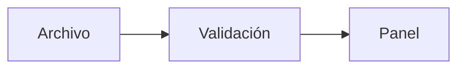

# Formato de un libro de Estante

Un libro es un solo Markdown: `projects/INFO_PROYECT_<NOMBRE>.md`. El parser no inventa nada. Toma la estructura del MD y la convierte en capítulos, callouts, glosario, banco de preguntas y referencias a archivos. Este documento es el contrato. Si un MD lo sigue, el libro aprovecha todas las funciones de la app. Si no, compila igual, pero `bun run books:check` avisa de lo que falta.

La plantilla del final se compila en `tests/core/format-doc.test.ts`. Si cambias el parser, esa prueba avisa si este documento quedó desactualizado.

## Reglas

| En el MD                                                                                                                                                                                                                                                          | En el libro                                                                                                                        |
| ----------------------------------------------------------------------------------------------------------------------------------------------------------------------------------------------------------------------------------------------------------------- | ---------------------------------------------------------------------------------------------------------------------------------- |
| Frontmatter YAML opcional (`repo`, `branch`, `author`, `color`, `title`, `subtitle`, `root`)                                                                                                                                                                      | Metadatos. Con `repo: usuario/proyecto`, cada referencia a archivo enlaza a GitHub en su línea.                                    |
| `# Proyecto: subtítulo` (o `# Proyecto — subtítulo`)                                                                                                                                                                                                              | Título y subtítulo, separados por el primer `:` o raya                                                                             |
| Texto antes del primer `##`                                                                                                                                                                                                                                       | Capítulo "Introducción"                                                                                                            |
| `## Índice…` con una lista de enlaces `#ancla`                                                                                                                                                                                                                    | Se usa para validar que no falte ningún capítulo. En el libro lo reemplaza el índice nativo. Lo demás bajo ese `##` se conserva.   |
| `## N. Título`                                                                                                                                                                                                                                                    | Capítulo numerado. Sin numeración, cada `##` es un capítulo.                                                                       |
| `### N.M Título`                                                                                                                                                                                                                                                  | Sección del capítulo                                                                                                               |
| Párrafo que empieza con una etiqueta en negrita: `**Implementado:**`, `**Interpretación técnica:**`, `**Por verificar:**`, `**Evolución posible:**`, `**Límite real:**`, `**Matiz …:**`, `**Pregunta probable:**`, `**Nota:**`, `**Importante:**`, `**Consejo:**` | Callout con color. La lista completa está en `src/adapters/build/remark/rules.ts`.                                                 |
| `> texto` y `> [!WARNING]`                                                                                                                                                                                                                                        | Callout de aviso                                                                                                                   |
| Bloque ` ```ts `, ` ```bash `…                                                                                                                                                                                                                                    | Código resaltado (Shiki), con visor a pantalla completa                                                                            |
| Bloque ` ```mermaid `                                                                                                                                                                                                                                             | Diagrama SVG claro y oscuro. Se renderiza en local con `bun run build` y se guarda en la caché local `.estante-cache/diagrams` (no se versiona). |
| `[texto](src/archivo.ts:15)` o `[texto](src/archivo.ts:15-20)`                                                                                                                                                                                                    | Chip de referencia `src/archivo.ts:15`. Usa rutas **relativas** a la raíz del proyecto.                                            |
| `[texto](#ancla)`                                                                                                                                                                                                                                                 | Salto interno a un capítulo o sección, con píldora para volver                                                                     |
| `[texto](https://…)`                                                                                                                                                                                                                                              | Enlace externo                                                                                                                     |
| Tabla bajo un `##`/`###` que contiene "Glosario"                                                                                                                                                                                                                  | Glosario. La primera columna es el término. `A / B` declara alias. La segunda es la definición.                                    |
| `**N. ¿Pregunta?** Respuesta`, en el mismo párrafo                                                                                                                                                                                                                | Pregunta del banco. La respuesta se oculta hasta tocarla, y la pestaña Práctica la convierte en tarjeta.                           |
| `**"¿Pregunta?"**` seguida de la respuesta, dentro de un `##`/`###` que dice "Pregunta"                                                                                                                                                                           | También es pregunta del banco, numerada por orden. Se acepta por compatibilidad; para libros nuevos usa el formato numerado.       |
| `- [ ] tarea`                                                                                                                                                                                                                                                     | Checklist que guarda su estado                                                                                                     |
| Párrafo entero entre comillas “…”                                                                                                                                                                                                                                 | Guion para decir en voz alta                                                                                                       |

## Lo que debe tener un libro completo

- **Banco de preguntas** con el formato exacto `**N. ¿…?** respuesta`: número, punto, pregunta en negrita y la respuesta en la misma línea. Sin esto, Práctica queda vacía para el libro.
- **Glosario** como tabla bajo un encabezado que diga "Glosario". Sin esto, los términos no tienen definición al tocarlos.
- **Referencias a archivos** con ruta relativa y línea, más `repo:` en el frontmatter si el proyecto está en GitHub.
- **Índice** con enlaces a cada capítulo, para que `books:check` detecte capítulos que falten.

## Plantilla

````markdown
---
repo: usuario/mi-proyecto
author: Tu nombre
---

# Mi proyecto: libro de estudio para defenderlo en una entrevista

Esta guía explica qué hace el proyecto, cómo se conectan sus piezas y qué límites tiene. Está basada en la lectura del código.

## Índice de estudio

1. [Qué resuelve](#1-qué-resuelve).
2. [Arquitectura](#2-arquitectura).
3. [Glosario](#3-glosario).
4. [Banco de preguntas](#4-banco-de-preguntas).

## 1. Qué resuelve

El proyecto convierte un archivo de configuración en un panel. La entrada vive en [main.ts](src/main.ts:12).

“Mi proyecto lee la configuración, la valida y la muestra como un panel.”

**Implementado:** la validación ocurre en [validate.ts](src/validate.ts:8-30) antes de renderizar.

**Por verificar:** no hay pruebas de rendimiento con archivos grandes.

### 1.1 Recorrido de una petición

```ts
export function load(path: string) {
  return validate(read(path));
}
```



## 2. Arquitectura

**Interpretación técnica:** es una arquitectura en capas: lectura, validación y vista.

**Límite real:** todo corre en un solo proceso.

> [!WARNING]
> La configuración no se cifra.

## 3. Glosario

| Término                     | Definición                                                |
| --------------------------- | --------------------------------------------------------- |
| Validación                  | Comprobar que un dato cumple su contrato antes de usarlo. |
| SSR / Server-side rendering | Generar el HTML en el servidor al atender la petición.    |

## 4. Banco de preguntas

**1. ¿Qué problema resuelve el proyecto?** Convierte un archivo de configuración en un panel, validándolo antes de mostrarlo.

**2. ¿Dónde se valida la entrada?** En `src/validate.ts`, antes de renderizar.

- [ ] Puedo explicar el recorrido completo sin mirar el código.
````
